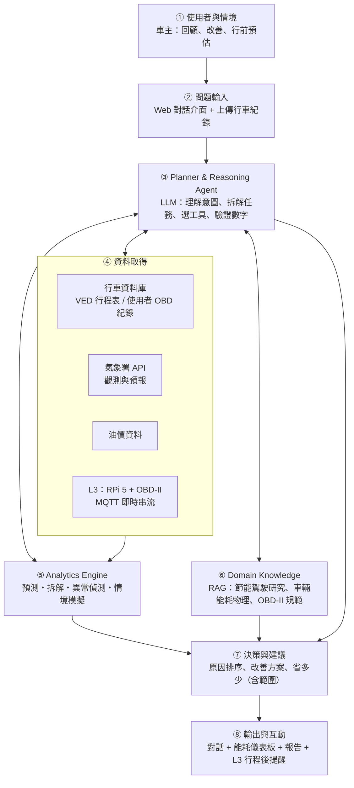
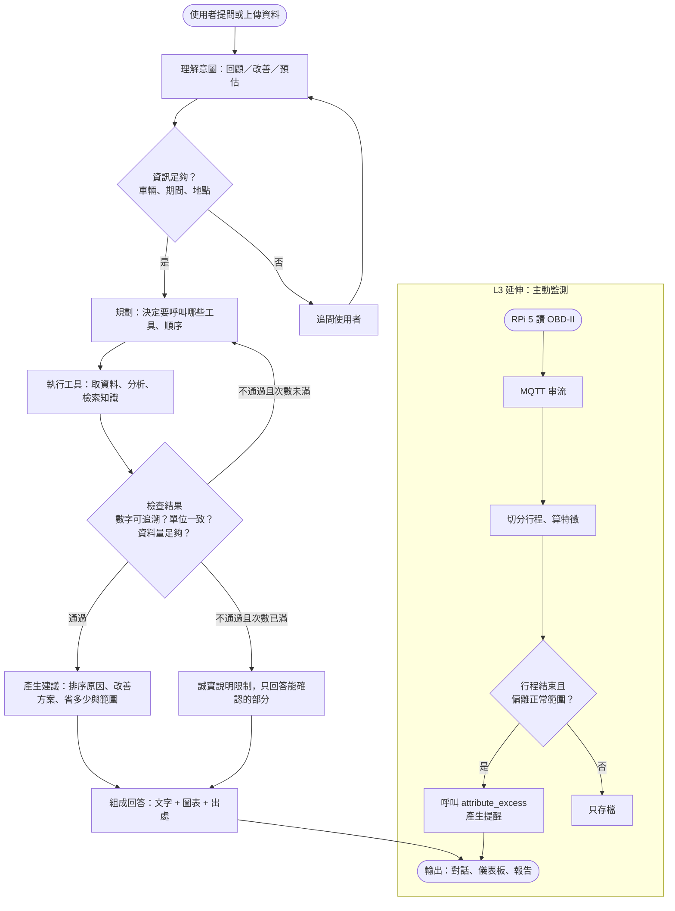

# 系統設計草稿：H. 車輛能耗偵探（Vehicle Energy Detective）

> 狀態：未採用（2026-10-25 ⑧ 定案為 D1 重機旅遊規劃顧問，H 保留為退路）。這份文件原本回答「如果選 H，系統要怎麼設計」。文中提到的汽車後來確認不是自己的車，已排除。
> 前提：⑨ = 實作 L2，L3 延伸；實際一人、週末進行。
> 依據：`architecture-scope.md`（老師的 ①–⑩）、`shortlist-a-vs-h.md`、`spike-ved.md`（VED 驗證結果）。

## 1. 一句話定位

一位懂車輛能耗的 AI 專家：讀你的行車資料，用可驗證的計算告訴你「多耗的油是天氣、路況還是開法造成的」，並估算改變開法每月能省多少錢。

**設計原則（對應老師的核心要求）：LLM 只負責理解、規劃和解釋；所有數字都由分析工具算出，回答裡的每個數字都要追得回工具的輸出。**

## 2. 使用者與情境（①）

**主要使用者：** 台灣的燃油車或油電車車主。台灣 2025 年新車中電動車約佔 8%，路上大多是燃油車和油電車；VED 的主體也正好是這兩類車。

| 情境 | 使用者會問 | Agent 要做的事 |
| --- | --- | --- |
| S1 回顧診斷 | 「我上週比平常多耗油，為什麼？」 | 比較本週和平常的行程，把多出來的油耗拆成天氣、車速、怠速、加速 |
| S2 改善建議 | 「我的開法哪裡可以改？一個月能省多少？」 | 找出可改善的駕駛特徵，模擬改善後的油耗，換算成公升和新台幣 |
| S3 行前預估 | 「明天開台中到台北，天氣很熱，大概耗多少油？」 | 查氣象署預報，用模型預估油耗和範圍 |
| S4 異常提醒（L3） | （不用問）行程結束後主動通知 | 這趟油耗明顯偏離同車的正常範圍時提醒，附可能原因 |

## 3. 系統架構

Proposal 架構圖依作業規範用 ①–⑧ 編號：



### 各模組說明

| 編號 | 模組 | 內容 | 對應老師框架 |
| --- | --- | --- | --- |
| ① | 使用者與情境 | 第 2 節的四個情境 | ① |
| ② | 問題輸入 | Web 對話；可上傳 OBD 紀錄（CSV）或選示範車輛 | ② |
| ③ | Planner & Reasoning Agent | LLM 工具呼叫迴圈：理解意圖 → 缺資訊就追問 → 規劃工具順序 → 執行 → 檢查數字 → 不通過就重新規劃（有次數上限） | ③-1、③-2、④ THINK |
| ④ | 資料取得 | 行車資料庫、氣象署 API、油價、L3 的即時串流 | ③-3、⑤-1～⑤-3、④ SENSE |
| ⑤ | Analytics Engine | 第 5 節的工具，全部是確定性的 Python 計算 | ③-4、⑥、④ ANALYZE |
| ⑥ | Domain Knowledge | 知識庫加檢索，回答時附出處 | ⑤-4、④ KNOW |
| ⑦ | 決策與建議 | 依分析結果排序原因、產生改善方案，每項附數字和不確定範圍 | ③-5 |
| ⑧ | 輸出與互動 | 對話、圖表、可下載的報告；L3 加上行程後提醒 | ③-6、⑦、④ TALK / SHOW |

## 4. 資料

| 來源 | 用途 | 狀態 |
| --- | --- | --- |
| VED（8,976 趟可用行程、172 台車） | 訓練模型；當「示範車輛」讓沒有自己資料的人也能試用 | spike 已驗證 |
| NOAA 歷史天氣（密西根） | 補 VED 缺少的車外溫度，樣本可從約 9 千趟增加 | 待做 |
| 氣象署 API | 台灣的觀測和預報，用在 S3 行前預估和台灣示範 | HW1 用過，可沿用 |
| 油價（中油公告價） | 把公升換算成新台幣 | 來源待確認 |
| 使用者 OBD-II 紀錄 | L2：上傳 CSV；L3：RPi 5 即時串流 | 取決於車款支援的參數，待確認 |
| 知識庫文件 | 節能駕駛研究、VED 論文、車輛能耗物理、OBD-II 參數說明、政府節能駕駛資料 | 待蒐集 |

### 取得方式（2026-10-24 查證）

| 來源 | 怎麼取得 | 能提供 | 不能提供 | 查證狀態 |
| --- | --- | --- | --- | --- |
| VED | GitHub 直接下載兩個 7z（約 176 MB） | 車速、MAF、車外溫度、燃油修正；可推算油耗 | 台灣路況；冷車啟動段 | 已下載驗證 |
| 氣象署 API | 用 HW1 申請的授權碼 | 台灣觀測與預報 | 歷史行程當下的天氣要自己對時間地點 | HW1 用過 |
| 中油牌價 | 政府資料開放平台「中油主產品牌價」，XML API，每 7 日更新 | 汽柴油最新牌價 | 汽油歷史牌價（開放資料只找到最新牌價） | 已查到資料集頁面，API 未實測 |
| 自己的車：手機 App + ELM327 | OBD-II 插座接 ELM327，用手機 App 記錄後匯出 CSV（Android 的 Torque Pro 等 App 支援 CSV 匯出） | 車速、轉速、MAF 或 MAP+IAT（可推算油耗）、部分車款有車外溫度 | 車廠專屬參數 | App 的 CSV 匯出功能未實測；車款支援度未確認 |
| 自己的車：RPi 5 + ELM327（L3） | python-obd 讀取，經 MQTT 串流 | 同上，加上即時性 | 同上 | 未實測 |
| 行車記錄器檔案 | 有 GPS 的機型會把時間、經緯度、車速寫在影片裡，可用 `exiftool -ee` 取出 | 車速曲線、路線、時間（可算怠速、停車、加速、對接天氣） | 油耗、MAF、轉速、溫度，所以**無法當正確答案** | 依機型而定，要用實際檔案測 |

**限制（2026-10-24 決定）：不在車上加裝任何東西**（不插 OBD 讀取器、不裝車機）。自有車輛的資料改用不需加裝的來源：

| 來源 | 能提供 | 層級 | 狀態 |
| --- | --- | --- | --- |
| 手機 GPS 記錄（手機帶在身上即可） | 車速曲線，可算怠速、停車、加速、路線；可對接氣象署天氣 | 每趟行程 | 和機車 GPX 同一套方法，已用 GPX 驗證可行 |
| 加油紀錄（加滿法：里程、公升數） | 實際油耗，當正確答案 | 每一箱油 | 從現在開始記錄即可 |
| 儀表的旅程電腦（每箱油或每趟歸零後拍照） | 車輛自己估算的平均油耗 | 每趟或每箱 | 是估算值，只能當參考 |
| 和泰 Drive+ 車聯網 App「旅程日誌」（RAV4，若有此服務） | 每趟行程軌跡、駕駛習慣、節能表現 | 每趟行程 | 要確認車上有沒有 Drive+；能否匯出未確認 |
| FordPass（Mustang） | 沒查到汽油版 Mustang 的行程油耗紀錄；Mach-E 車主回報行程數據常出錯 | — | 不列為資料來源 |

驗證方式：用 VED 訓練的模型預測同一箱油期間每趟行程的油耗，加總後和該箱油的實際油耗比較。到明年 1 月每台車大概只能累積少數幾箱，所以定位成案例驗證，不是訓練資料。

L3 不加裝的做法（待驗證）：手機當感測器，用支援 MQTT 的定位 App（例如開源的 OwnTracks）把位置送到家裡 RPi 5 的 MQTT broker，由 RPi 切分行程、算特徵、行程結束後推播。

以下 OBD-II 資訊保留作參考，在「不加裝」的限制下不使用：

**自有汽車（2026-10-24）：** Toyota RAV4 和 Ford Mustang Dark Horse 都有標準 OBD-II 插座：

- 標準參數（Mode 01）理論上可讀：車速、轉速、MAF、進氣溫度、車外溫度、燃油修正；實際支援哪些，要用讀取器查詢支援清單（PID 00）才知道。
- 有車主回報 2020 年 RAV4 油電版的通訊協定是 CAN 11-bit / 500 kbps，標準 OBD-II 讀得到；油電電池 SOC 等資料要用 Toyota 專屬參數（[AutoPi 社群](https://community.autopi.io/t/rav4-2020-hybrid-sniffing/2401)）。
- Mustang Dark Horse 的參數支援和是否有安全閘道限制，沒查到資料，要實測。
- 讀取器選有品牌的（例如 Car Scanner 開發者推薦 OBDLink、Vgate 等），開發者提醒便宜的仿製品可能連不上或讓引擎運轉不穩（[Car Scanner 說明](https://www.apkmirror.com/apk/car-scanner-llc/car-scanner-elm-obd2/car-scanner-elm-obd2-1-87-2-release/)）。
- 兩台車剛好對應 VED 的兩個主要類別：Mustang 是燃油車；RAV4 若是油電版就是油電車。

**自有機車（2026-10-24 查證）：**

| 車 | 能拿到的資料 | 限制 |
| --- | --- | --- |
| BMW R1250GS | BMW Motorrad Connected App 可把行程匯出成 GPX（路線和時間，可算車速）；App 內可看轉速、傾角、油量，但匯出車輛數據未確認；ECU 即時數據要用 GS-911（第二代）或 Touratech Connect 硬體 | 原廠協定，一般 ELM327 不一定能用；能否記錄燃油流量未確認 |
| SYM 機車 | 診斷接頭規格、協定、是否有可記錄數據的 App 都沒查到 | 要向 SYM 或服務據點確認 |
| 兩台共通 | 手機 GPS 記錄行程；每次加滿油記錄里程和公升數（加滿法），當油耗的正確答案 | 正確答案只到「每一箱油」的層級，到明年 1 月累積的箱數有限 |

**實際 GPX 檢查（R1250GS，2022-12-23 一趟約 55 分鐘、30 km，程式在 `final_project/spike/gpx/`）：**

- 每個點只有經緯度、高度、時間，沒有車速、轉速、傾角等擴充欄位。
- 取樣約 1 秒一點（中位數 1 秒、90% 在 2 秒內），和 VED 的車速取樣頻率相同；行程被切成 11 段，段間最長空白 22 秒。
- 可以算出開法特徵：怠速比例 29%、停車 22 次（每公里 0.73 次）、加速激烈程度 PKE 1.1。
- 雜訊：由位置差推算的車速有 2 個點超過 200 km/h，要先平滑；GPS 高度跳動大，累積爬升 553 m 不可信，坡度要改用地形資料。
- PKE 明顯高於 VED 汽車（中位數約 0.35），一部分是機車本身，一部分是 GPS 雜訊放大，不能直接套用汽車模型。
- 結論：GPX 能提供「開法」這一半的特徵；油耗的正確答案仍要靠加油紀錄。

**可加裝的車機／記錄工具（2026-10-24 查證，價格未查證）：**

| 工具 | 能拿到的數據 | 能不能匯出 | 和油耗的關係 | 適合度 |
| --- | --- | --- | --- | --- |
| BMW Motorrad Connected（已有） | 路線、時間；App 內看轉速、傾角、油量 | GPX（只有路線和時間，已用實際檔案確認） | 無 | 已可用 |
| Carpuride W702BS | 透過 Wonder Wheel 顯示車速、轉速、里程；原車有 TPMS 才能顯示胎壓 | 沒有記錄或匯出功能 | 無 | 不適合當資料來源 |
| Chigee AIO-5 Play for BMW | 透過 BMW 導航預備（Nav5/6 支架）讀原車數據：轉速、車速、傾角、油溫、旅程數據、胎壓；需要啟用 0272 導航數據包 | 沒查到記錄或匯出功能 | 沒查到油耗 | 低：和 Carpuride 一樣主要是顯示器 |
| Touratech Connect | CAN 匯流排上 60 多項數值：檔位、車速、煞車、傾角、油箱存量等 | GPX、最大值和計數值的紀錄簿、全部資料打包成 zip；是否有逐秒時間序列未確認 | 只有油箱存量，沒看到油耗 | 中 |
| WunderLINQ（硬體模組 + 免費 App） | 模組裝在導航預備支架上（取代原廠 Navigator），被動讀 CAN，25 項以上數據，包含車上電腦的油耗、旅程里程、平均車速；用藍牙把數據送到手機 | 有位置和數據記錄、自動行程記錄，可匯入試算表；欄位未確認；主 App 沒找到原始碼，但官方在 GitHub 公開了讀取數據的 Android 範例程式 | 有車上電腦算的油耗（是估算值，不是實測） | 高，但要求車上有 Onboard Computer Pro 和導航預備選配 |
| GS-911（第二代） | ECU 即時數據多個通道 | 記錄在手機或電腦，匯出分號分隔的 CSV；取樣 0.4–2.5 秒，通道越多越慢 | 是否有噴油相關通道未確認 | 中高；2017 年後的車要轉接線 |
| MotoScan + OBDLink | 即時數據 | R1250GS 支援度和 CSV 匯出都未確認；有論壇反映記錄不順 | 未確認 | 低 |
| RaceChrono + OBDLink MX+（CAN 模式） | 直接讀 CAN，約每秒 40 筆 | 可 | 要自己解碼 BMW 的 CAN 訊息，R1250GS 沒有現成對照表 | 低到中 |
| 自製：RPi 5 + CAN HAT 只聽模式 | 匯流排上所有廣播訊息 | 完全自控，可直接接 MQTT | 要自己解碼；社群有 BMW Motorrad CAN 訊息表和 R1200GS 的 Arduino 側錄專案，但作者說部分資訊有誤 | 最符合 L3 和車用背景，但工作量最大；必須只聽不發送 |
| AiM Solo 2 DL | 賽道記錄器，可接 ECU | 可 | 官方只列 S1000RR，沒有 R1250GS | 不適合 |
| SYM MotorLove App（官方） | 保養預約、加油紀錄 | 未確認 | 加油紀錄可當正確答案 | 有論壇反映註冊和資料問題 |
| SYM 診斷接頭 | 規格、協定都沒查到 | — | — | 要問 SYM 服務據點 |

重點：查到的工具裡，沒有一個確定能提供燃油流量。和油耗最接近的是 WunderLINQ 讀到的「車上電腦油耗」（車輛自己的估算），正確答案仍然要靠加油紀錄。

公開的機車資料：沒有找到台灣機車的行程級能耗資料集；政府資料開放平台有「[機車動態能源消耗及碳排放係數](https://data.gov.tw/en/datasets/33215)」，是依道路類型的彙總係數，可以當領域知識，不能當訓練資料。

**即時資料：** 沒有公開的個別車輛即時能耗資料可用（隱私限制）。真正的即時資料只能來自自己的車；沒有的話，用 VED 重播模擬，並明確標示是重播。

**統一的行程格式**（VED 和使用者的資料都轉成這個格式，分析工具只認這個）：
行程 ID、車輛 ID、日期時間、距離、時間、平均車速、怠速比例、停車次數、PKE（加速激烈程度）、車外溫度、油耗（L/100km）、資料來源（VED／上傳／即時）。

## 5. Analytics Engine：工具清單

每個工具輸入和輸出都是 JSON，輸出包含數字、單位、不確定範圍和資料來源，LLM 只能引用、不能自己算。

| 工具 | 功能 | 方法 |
| --- | --- | --- |
| `summarize_trips` | 指定車輛和期間的行程統計 | pandas 彙整 |
| `predict_consumption` | 給定行程條件，預測油耗和範圍 | 多元迴歸（baseline）、梯度提升樹；用分位數迴歸或 conformal 方法給預測區間 |
| `attribute_excess` | 把「比平常多耗的部分」拆成天氣、車速、怠速、加速的貢獻 | 反事實：把各因素換回參考值，看預測差多少；線性模型可以精確拆分，樹模型用 SHAP |
| `detect_anomaly` | 找出明顯偏離同車正常範圍的行程 | 同車殘差的 z 分數；Isolation Forest 當對照 |
| `simulate_savings` | 「如果怠速和加速改善到某個程度，能省多少」 | 調整特徵後重新預測，換算公升和新台幣，附範圍 |
| `forecast_trip` | 依路程和天氣預報預估油耗 | 氣象署預報 + `predict_consumption` |
| `get_weather` | 查觀測或預報 | 氣象署 API |
| `get_fuel_price` | 查目前油價 | 中油公告價 |
| `search_knowledge` | 檢索知識庫，回傳段落和出處 | 向量檢索 |

spike 已經證明 `predict_consumption`（R² 0.81）和 `attribute_excess` 的核心計算可行。

## 6. 處理流程（Flowchart）



## 7. 核心演算法（Pseudocode）

```text
Algorithm 1: Vehicle Energy Detective Agent
Input : user query Q, vehicle id v (optional), trip store S, knowledge base KB
Output: answer R with numbers, ranges, and citations

01: intent, slots ← UNDERSTAND(Q)                     ▷ review / improve / forecast
02: if REQUIRED(intent) ⊄ slots then
03:     return ASK_USER(missing slots)
04: plan ← PLAN(intent, slots, available tools)        ▷ ordered tool calls
05: evidence ← ∅ ; attempts ← 0
06: repeat
07:     for each step in plan do
08:         result ← CALL_TOOL(step, slots, evidence)  ▷ deterministic Python
09:         evidence ← evidence ∪ {result}
10:     ok, issues ← VERIFY(evidence)                  ▷ sample size, units, ranges
11:     if not ok then plan ← REPLAN(plan, issues) ; attempts ← attempts + 1
12: until ok or attempts ≥ MAX_ATTEMPTS
13: findings ← RANK_CAUSES(evidence)                   ▷ by attributed L/100km
14: actions ← RECOMMEND(findings, SEARCH(KB, findings))
15: draft ← COMPOSE(findings, actions, citations)      ▷ LLM writes, tools supply numbers
16: if NUMBERS(draft) ⊄ NUMBERS(evidence) then         ▷ every number must be traceable
17:     draft ← COMPOSE(findings, actions, citations, strict = true)
18: R ← RENDER(draft, charts(evidence))
19: return R
```

第 16 行是這個設計的重點之一：回答裡出現的數字，必須都能在工具輸出裡找到，否則重寫。這直接回應老師說的「避免學生最後只是做出不同外觀的 ChatGPT」。

## 8. 介面（⑧）

| 畫面 | 內容 |
| --- | --- |
| 對話 | 自然語言提問，回答附圖表和出處，可追問 |
| 能耗儀表板 | 每趟行程油耗時間軸；溫度對油耗的 U 型曲線，疊上使用者自己的行程；異常行程標記 |
| 原因拆解圖 | 瀑布圖：參考油耗 → 天氣 → 車速 → 怠速 → 加速 → 實際油耗 |
| 改善報告 | 可下載，列出改善項目、預估省下的公升和新台幣（含範圍）、依據的研究 |
| L3 提醒 | 行程結束後推播，不在行車中顯示 |

## 9. 技術選擇（建議，待定）

| 層 | 建議 | 理由 |
| --- | --- | --- |
| 分析 | Python：pandas、scikit-learn、statsmodels | spike 已經用這套跑通 |
| Agent | 自己寫的工具呼叫迴圈，不用大型框架 | 好解釋、好畫 Pseudocode，你本來就熟 Agent 開發 |
| LLM | 支援工具呼叫的 API 模型 | 訂閱方案不含 API 用量，需要另外的 API key 和少量費用；選哪家待定 |
| 知識庫 | 本機向量檢索（例如 Chroma 或 SQLite 向量擴充） | 資料量小，不需要外部服務 |
| 資料儲存 | DuckDB 或 SQLite | 單機、免架設 |
| 介面 | Streamlit（最快）或 FastAPI + 前端 | 一個人做，優先 Streamlit |
| L3 | RPi 5 + python-obd + Mosquitto MQTT | 只讀、被動記錄 |
| 推播 | Email 或 Telegram | LINE Notify 已停止服務，若要用 LINE 需改用 Messaging API |

## 10. 實驗設計（⑩、期末 Experiments）

| 實驗 | 比較 | 指標 |
| --- | --- | --- |
| E1 能耗預測 | 平均值 baseline、多元迴歸、梯度提升樹、物理模型 + 殘差 | 依車輛分組交叉驗證的 MAE、RMSE、R²、預測區間覆蓋率 |
| E2 原因拆解的可信度 | 拆解出的溫度效應 vs 同車固定效果迴歸的估計 | 兩者是否一致（spike：同車 -8°C 比 20°C 多約 14%） |
| E3 Agent 回答品質（消融實驗） | 只用 LLM、LLM + 知識庫、完整 Agent（LLM + 工具 + 知識庫） | 用約 30 題、答案由工具算出的題庫，量測數字正確率、可追溯率、工具呼叫正確率 |
| E4 案例研究 | 2–3 個完整情境示範（S1–S3） | 質性說明 |
| E5（L3 選做） | 自己的車實際行程 | 資料完整度、提醒的合理性 |

E3 是 Proposal 很好的賣點：它直接證明「加了分析工具的 Agent，比單純的聊天機器人更可信」。

## 11. L2 與 L3 的範圍

| 部分 | L2（承諾） | L3（延伸） |
| --- | --- | --- |
| 資料 | VED 示範車輛 + 使用者上傳 CSV | RPi 5 即時串流自己的車 |
| 互動 | 使用者提問才回答 | 行程結束主動提醒 |
| 天氣 | 氣象署 API 查詢 | 自動對接行程時間地點 |

## 12. 待決定事項

- [ ] ⑧ 是否定案選 H
- [ ] 示範用的「車主」：直接用 VED 某台車，還是等自己的車有資料
- [ ] LLM 供應商和 API 預算
- [ ] 介面用 Streamlit 還是 FastAPI + 前端
- [ ] 油價資料來源
- [ ] 自有汽車（RAV4 應為汽油版、Mustang Dark Horse）不加裝任何東西：確認 RAV4 有沒有和泰 Drive+ 車聯網；開始記錄加油紀錄和手機 GPS 行程（機車只當選做案例）
- [ ] 正式專題 repo 要另開，還是放在本 repo 的 `final_project/`
