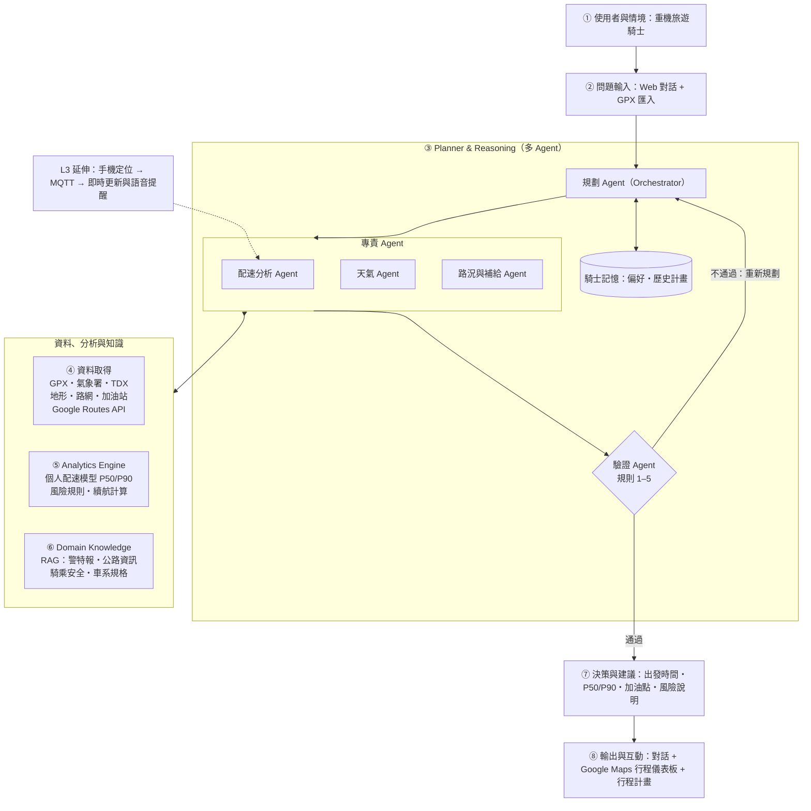

# 4. Proposed Scheme 系統設計

> 草稿（2026-10-31）。依 `doc/brief/architecture-scope.md` 的 ①–⑩ 決定撰寫，章節依 A–Z SOP 的 PA–PM。
> 引用編號沿用 2. Related Work 的 [1]–[19]、3. Deep Research 的 [D#]、1. Introduction 的 [I#]；組成 Word 時統一成一份參考文獻。
> 本章只描述設計與預期，不含任何 D1 的實驗結果。

## 4.1 研究目標（PA）

本專題要建立一位重機旅遊規劃代理人，回答騎士出發前最常問、也最容易判斷錯的三個問題：

1. 這趟路以**我自己的騎法**要騎多久？最晚幾點會回到家？
2. 依各路段的**預計抵達時間**，天氣、日照和路況是否允許？
3. 依續航和加油站營業時間，**哪裡加油**才不會沒油？

正式問題定義：給定起點、路線（或途經點）、出發日期、騎士限制（最晚回程時間、最長騎乘時數），以及騎士自己的歷史行程，系統要輸出一份**可行**的行程計畫，包含建議出發時間、各段預計抵達時間的範圍（P50 / P90）、加油點和風險說明；若不存在可行計畫，要說明哪一個條件無法滿足。

## 4.2 理論與技術基礎（PB）

| 基礎 | 用在本專題 | 來源 |
| --- | --- | --- |
| 路段式旅行時間估計：整趟時間由各段時間組成 | 配速模型以路段為單位預測再加總 | DeepTTE [1]、Google Maps ETA [2] |
| 機率式旅行時間：輸出分佈而非單點 | 預測 P50 / P90，而不是單一時間 | ProbETA [3] |
| 地形特徵預測移動速度 | 用坡度、彎道等地形特徵預測個人速度 | 登山配速 GLM [10]、機車速度模型 [7][8] |
| LLM 規劃需要外部驗證 | LLM 負責規劃，驗證交給確定性的工具 | TravelPlanner [4]、LLM+SMT [5]、LLM-Modulo [13] |
| 山區午後對流的時空分佈 | 依預計抵達時間查天氣，避開午後高峰 | Lin et al. [11] |
| 山區道路因降雨封閉 | 路況與封路風險規則 | Yang et al. [12] |

## 4.3 問題成因與解法（PC：Cause → Mechanism → Solution）

| 成因 | 機制 | 解法 |
| --- | --- | --- |
| 一般導航的預估時間是群體平均，不知道這位騎士在彎道多的山路騎多快 [2][8] | 個人差異在彎道和坡道最大，整趟平均速度會掩蓋最難的路段 [D1] | **個人配速模型**：以騎士自己的 GPX 訓練，逐段預測時間，並輸出 P50 / P90 區間 |
| 天氣、日照、加油、路況分散在不同來源，騎士要自己換算時間 | 規劃時看的是「出發時」的天氣，不是「抵達該路段時」的天氣 [11][D4] | **多 Agent 分工**：配速 Agent 先算出各段抵達時間，天氣、路況與補給 Agent 再依那個時間查詢 |
| LLM 自己做時間與距離計算不可靠 [4][6] | 長鏈推理中的數字錯誤不會被發現 | **驗證 Agent**：以確定性規則檢查整份計畫，不通過就退回重新規劃 [5][13] |

## 4.4 系統架構（PD、PG）

架構依作業規範的 ①–⑧ 模組編號：



### 模組說明

| 編號 | 模組 | 內容 |
| --- | --- | --- |
| ① | 使用者與情境 | 在台灣騎重機旅遊的騎士；情境為行程規劃、出發前檢查天氣與路況、油量與加油點；L3 延伸為騎乘中提醒 |
| ② | 問題輸入 | Web 對話介面；用地名描述行程，或在地圖上選點；匯入 GPX 建立與更新個人配速 |
| ③ | Planner & Reasoning | 五個 Agent 分工（見 4.4.1）；驗證不通過就重新規劃；記住騎士偏好與過去計畫 |
| ④ | 資料取得 | 自己的 GPX、氣象署、TDX、內政部地形（DTM）、OpenStreetMap、中油加油站、Google Maps Routes API |
| ⑤ | Analytics Engine | 個人配速模型（P50 / P90）、天氣與路況風險規則、續航與加油站檢查、日照檢查；全部是確定性的 Python 工具 |
| ⑥ | Domain Knowledge | 知識庫檢索：氣象署警特報說明、公路局行車資訊、騎乘安全資料、BMW 車系規格（油箱、油耗）、相關研究；回答附出處 |
| ⑦ | 決策與建議 | 建議出發時間、各段抵達時間範圍、加油點、風險排序與理由；不可行時說明原因與替代方案 |
| ⑧ | 輸出與互動 | 對話回答；Google Maps 行程儀表板（路段依時間與風險上色、加油站、日落時間）；可下載的行程計畫 |

### 4.4.1 多 Agent 分工

| Agent | 輸入 | 輸出 | 工具 |
| --- | --- | --- | --- |
| 規劃 Agent | 使用者問題、騎士記憶 | 任務分派、彙整後的計畫草案 | 知識庫檢索 |
| 配速分析 Agent | 路線、出發時間、騎士 ID | 各段 P50 / P90 時間、各點 P50 與 P90 預計抵達時刻（4.6） | 路線切段、地形特徵、配速模型、Google 預估時間 |
| 天氣 Agent | 各段位置與 P50 / P90 預計抵達時刻 | 各段降雨機率、溫度、警特報；民用暮光終 | 氣象署預報、觀測、日出日沒資料 |
| 路況與補給 Agent | 路線、各點 P90 預計抵達時刻、車型 | 路況事件、可用加油站（含營業時間）、續航檢查 | TDX、中油加油站、車系規格 |
| 驗證 Agent | 完整計畫草案 | 通過，或違反的規則清單 | 驗證規則（4.6） |

### 4.4.2 對應課程框架

課程專題說明以三個框架描述一位合格的領域代理人：③ 的標準 Agent Workflow、④ 的六大能力、⑨ 的實作 Level。本專題的對應如下。

**Agent Workflow（③-1 至 ③-6）**

| 階段 | 本專題的做法 | 負責 |
| --- | --- | --- |
| ③-1 Understand 理解需求 | 取出起訖點、路線、日期、最晚回程時間等限制；缺資訊就追問 | 規劃 Agent |
| ③-2 Plan 規劃推理 | 決定工具順序，並產生候選出發時間 | 規劃 Agent |
| ③-3 Acquire 取得資料 | 自己的 GPX、氣象署預報與觀測、TDX 路況、地形與路網、加油站 | 配速、天氣、路況與補給 Agent |
| ③-4 Analyze 資料分析 | 個人配速模型（P50 / P90）、風險規則、續航計算 | 配速分析 Agent 與 Analytics Engine |
| ③-5 Generate 生成建議 | 經驗證 Agent 檢查後，產生出發時間、加油點與風險說明；不可行時提出替代方案 | 驗證 Agent、規劃 Agent |
| ③-6 Interact 互動呈現 | 對話回答、Google Maps 行程儀表板、可下載的行程計畫 | 規劃 Agent |

**六大能力（④）**

| 能力 | 本專題的做法 |
| --- | --- |
| TALK 會對話 | 多輪對話，主動追問缺少的條件 |
| KNOW 專業知識 | 知識庫檢索氣象署警特報說明、公路局行車資訊、騎乘安全資料、車系規格與相關研究，回答附出處 |
| SENSE 取得資料 | 騎士自己的 GPX 行程（約 1 秒一點）與政府開放資料；L3 加上騎乘中的手機定位串流 |
| ANALYZE 資料分析 | 分位數梯度提升樹預測路段時間與區間，並和多元迴歸、平均速度、Google 預估時間比較 |
| THINK 自主決策 | 多 Agent 分工、驗證不通過就重新規劃、記住騎士偏好 |
| SHOW 呈現成果 | 依路段時間與風險上色的地圖、時間軸、行程計畫；L3 加上語音提醒 |

**實作 Level（⑨）**

| Level | 在本專題的內容 | 範圍 |
| --- | --- | --- |
| L1 LLM + Data | 對話介面、讀取 GPX 與開放資料、Python 分析、圖表 | 包含在 L2 內 |
| L2 Knowledge Agent | 知識庫檢索、多 Agent 多步推理、驗證與重新規劃 | 承諾完成 |
| L3 IoT Autonomous Agent | 騎乘中手機定位經 MQTT 回傳，即時更新抵達時間並語音提醒 | 延伸，期末視進度 |

## 4.5 核心元素與符號（PE）

| 符號 | 意義 |
| --- | --- |
| $r = (s_1, \dots, s_n)$ | 一條路線切成 $n$ 個路段（約 0.5–2 km，或依道路切分） |
| $\mathbf{x}_i$ | 路段 $s_i$ 的特徵：曲率（每公里轉角、最小半徑）、坡度（DTM）、道路等級、公路局急彎與陡坡標記、時段、天氣、已騎里程 |
| $L_i$ | 路段長度 |
| $\hat{t}^{(q)}_i = \exp\big(f_q(\mathbf{x}_i)\big)$ | 個人配速模型對路段 $i$ 移動時間第 $q$ 分位數的預測（$q = 0.5, 0.9$ 即 P50 / P90 時間）；$f_q$ 以對數移動時間為目標訓練 |
| $d$ | 出發時間 |
| $\mathrm{ETA}^{(q)}_k$ | 抵達第 $k$ 個路段終點的第 $q$ 分位數時刻（$k = 1, \dots, n$） |
| $T^{(q)}$ | 整趟第 $q$ 分位數的騎乘時間（含休息），$T^{(q)} = \mathrm{ETA}^{(q)}_n - d$ |
| $T_{\text{dusk}}$ | 當日民用暮光終（氣象署資料）[D5] |
| $T_{\text{user}}$ | 騎士設定的最晚回程時間 |
| $R$ | 車輛續航（油箱容量 × 油耗，取自車系規格與騎士資料） |
| $G$ | 沿線加油站集合，含位置與營業時間 |

## 4.6 數學模型（PF）

**配速模型。** 以騎士自己的行程訓練，目標是路段移動時間的對數 $y_i = \log t_i$。分位數在單調遞增變換下不變，所以對數時間的第 $q$ 分位數取指數就是時間的第 $q$ 分位數：

$$\hat{t}^{(q)}_i = \exp\big(f_q(\mathbf{x}_i)\big), \qquad q \in \{0.5,\ 0.9\}$$

不以速度為目標再換算成時間：時間 $t = L/v$ 是速度的遞減函數，速度的第 0.9 分位數對應的是時間的第 0.1 分位數，若用速度的 P90 換算，P90 時間會變成最樂觀的估計，日照規則就會失效。

- Baseline：平均速度、速限換算、Google Maps 兩輪車預估時間。
- 模型一：多元迴歸（課程 L6）。
- 模型二：LightGBM，以分位數損失（pinball loss）分別學 $q = 0.5$ 與 $q = 0.9$：
  $\mathcal{L}_q(y, \hat{y}) = \max\big(q(y-\hat{y}),\ (q-1)(y-\hat{y})\big)$

**整趟區間。** 各段 P90 直接相加會高估整趟 P90（各段誤差不會同時最差）。因此整趟以各段 P50 相加，再用依行程分組的保留資料，校正「整趟實際時間 − 整趟預測」殘差的第 90 百分位（conformal 校正），得到整趟 P90：

$$T^{(0.9)} = \sum_i \hat{t}^{(0.5)}_i + B + \hat{c}_{0.9}$$

其中 $B$ 是休息時間，$\hat{c}_{0.9}$ 是校正量。

**各點抵達時刻。** 天氣、補給與驗證規則需要的是「抵達沿線某一點」的時刻，不只是整趟時間。P50 抵達時刻由各段 P50 時間累加；P90 抵達時刻把整趟校正量 $\hat{c}_{0.9}$ 依已騎里程比例分攤到該點：

$$\mathrm{ETA}^{(0.5)}_k = d + \sum_{i \le k} \hat{t}^{(0.5)}_i + B_k, \qquad \mathrm{ETA}^{(0.9)}_k = \mathrm{ETA}^{(0.5)}_k + \hat{c}_{0.9} \cdot \frac{\sum_{i \le k} L_i}{\sum_{i} L_i}$$

$B_k$ 是第 $k$ 段之前已排定的休息時間。配速 Agent 把 $\mathrm{ETA}^{(0.5)}_k$ 與 $\mathrm{ETA}^{(0.9)}_k$ 一併交給天氣與路況與補給 Agent；各段的 P90 時間 $\hat{t}^{(0.9)}_i$ 只用於地圖上色與找出最難的路段，不加總。

**可行性限制（驗證 Agent 的硬規則）：**

1. 日照：$d + T^{(0.9)} \le \min(T_{\text{dusk}}, T_{\text{user}})$
2. 續航：任兩個相鄰補給點（含起點）之間的距離 $\le R \times (1 - m)$，$m$ 為安全餘裕；且抵達該加油站的 P90 時刻 $\mathrm{ETA}^{(0.9)}_k$ 落在其營業時間內
3. 天氣：路段的抵達時段 $[\mathrm{ETA}^{(0.5)}_i, \mathrm{ETA}^{(0.9)}_i]$ 與大雨以上警特報範圍重疊時，該段標為高風險；高風險段不得位於日照限制最緊的最後一段
4. 路況：路段有 TDX 封閉或管制事件時，計畫不可行
5. 數字可追溯：回答中的每個時間、距離、機率都必須出現在工具輸出中

**決策問題。** 在可行的出發時間集合中，選擇讓「回程餘裕」最大、且高風險路段最少的出發時間：

$$d^{*} = \arg\max_{d \in \mathcal{D}_{\text{feasible}}} \Big( \min(T_{\text{dusk}}, T_{\text{user}}) - (d + T^{(0.9)}) \Big) \quad \text{s.t. 規則 1–5}$$

$\mathcal{D}$ 是候選出發時間（例如每 30 分鐘一個）。若 $\mathcal{D}_{\text{feasible}}$ 為空，回報違反的規則並提出替代方案（縮短路線、提前出發、改日）。

## 4.7 處理流程（PI：Flowchart）

```mermaid
flowchart TD
    A([騎士提問或匯入 GPX]) --> B{是匯入 GPX？}
    B -- 是 --> B1[清理車速跳點 → 切路段 → 算特徵] --> B2[更新個人配速模型] --> Z
    B -- 否 --> C[規劃 Agent 理解需求：起訖、路線、日期、限制]
    C --> D{資訊足夠？}
    D -- 否 --> D1[追問騎士] --> C
    D -- 是 --> E[配速分析 Agent：切段、預測 P50/P90、算各點抵達時間]
    E --> F[天氣 Agent：依抵達時間查各段天氣、暮光終]
    E --> G[路況與補給 Agent：路況事件、加油站、續航]
    F --> H[規劃 Agent 組成計畫草案]
    G --> H
    H --> I{驗證 Agent：規則 1–5 都通過？}
    I -- 否，次數未滿 --> J[依違反的規則調整：出發時間、加油點、路線] --> E
    I -- 否，次數已滿 --> K[說明不可行的原因與替代方案]
    I -- 是 --> L[產生建議：出發時間、P50/P90、加油點、風險與出處]
    K --> M
    L --> M[輸出：對話 + Google Maps 儀表板 + 行程計畫]
    M --> N{騎士要修改？}
    N -- 是 --> C
    N -- 否 --> O[寫入騎士記憶] --> Z([結束])

    subgraph L3["L3 延伸：騎乘中"]
        P1([手機定位]) --> P2[MQTT] --> P3[比對實際進度與 P90]
        P3 --> P4{落後或前方天氣變差？}
        P4 -- 是 --> P5[語音提醒，不需看畫面]
        P4 -- 否 --> P3
    end
```



例外處理：外部 API 失敗時，該 Agent 回報「資料不可用」，驗證 Agent 將相關規則視為未通過並在回答中說明，不以猜測補值。

## 4.8 核心演算法（Pseudocode）

```text
Algorithm 1: Moto Touring Copilot — Plan with Verification
Input : rider query Q, rider id u, trip store S_u, knowledge base KB
Output: feasible trip plan P with ranges and citations, or an infeasibility report

01: ctx ← UNDERSTAND(Q, MEMORY(u))                 ▷ origin, route, date, T_user, max hours
02: if MISSING(ctx) ≠ ∅ then return ASK_RIDER(MISSING(ctx))
03: route ← BUILD_ROUTE(ctx)                         ▷ waypoints → road segments s_1..s_n
04: X ← SEGMENT_FEATURES(route)                      ▷ curvature, DTM grade, road class, flags
05: D ← CANDIDATE_DEPARTURES(ctx)                    ▷ e.g. every 30 min
06: attempts ← 0 ; best ← ∅
07: repeat
08:     for each d in D do
09:         (t50, t90, ETA50, ETA90) ← PACE_AGENT(X, d, u)   ▷ segment times, ETAs (4.6)
10:         T90 ← ETA90[n] − d                        ▷ = Σ t50 + BREAKS + c_0.9
11:         W ← WEATHER_AGENT(route, ETA50, ETA90)    ▷ forecast, warnings, T_dusk
12:         F ← SUPPLY_AGENT(route, ETA90, VEHICLE(u)) ▷ stations (ETA90), range, events
13:         plan ← ORCHESTRATOR_COMPOSE(d, t50, t90, T90, W, F, SEARCH(KB, W, F))
14:         (ok, violations) ← VERIFY(plan)            ▷ rules 1–5, numbers traceable
15:         if ok and SLACK(plan) > SLACK(best) then best ← plan
16:     if best = ∅ then
17:         ctx ← REPLAN(ctx, violations) ; attempts ← attempts + 1
18: until best ≠ ∅ or attempts ≥ MAX_ATTEMPTS
19: if best = ∅ then return INFEASIBILITY_REPORT(violations, ALTERNATIVES(ctx))
20: SAVE_MEMORY(u, ctx, best)
21: return RENDER(best)                              ▷ chat + Google Maps dashboard + plan file
```

```text
Algorithm 2: Personal Pace Model Update
Input : new GPX trips G, existing trip store S_u
Output: updated models f_0.5, f_0.9 and conformal correction c_0.9

01: for each g in G do
02:     g ← TRIM_ENDS(g)                             ▷ remove home/work ends for privacy
03:     g ← CLEAN_SPEED(g)                           ▷ drop GPS spikes, smooth
04:     g ← SPLIT_MOVING(g)                          ▷ separate moving time from stops
05:     S_u ← S_u ∪ SEGMENTS(g)                      ▷ features from DTM, OSM, weather history
06: folds ← GROUP_KFOLD(S_u, by = trip)
07: f_0.5, f_0.9 ← FIT_QUANTILE_GBM(S_u, folds)      ▷ y = log moving time; MLR baseline
08: c_0.9 ← Q90(trip_actual − trip_predicted on held-out trips)
09: return f_0.5, f_0.9, c_0.9
```

## 4.9 範例（PJ）

以下為說明流程用的假設情境，數值為示意，不是實驗結果。

1. 騎士問：「週六新竹出發，走南橫當天來回，晚上七點前要回到家，幾點出發？」
2. 規劃 Agent 追問：「從哪一端進南橫？」騎士回答後，路線確定。
3. 配速分析 Agent 把路線切成數百個路段，依騎士過去在彎道山路的速度預測各段時間，並對每個候選出發時間算出各點預計抵達時間。
4. 天氣 Agent 發現依預計抵達時間，最高的山區路段會落在午後對流時段；路況與補給 Agent 找出山區前最後一個營業中的加油站。
5. 驗證 Agent 檢查：較晚的出發時間違反日照規則；某個出發時間的 P90 抵達加油站時間超過其營業時間。
6. 最後建議一個可行的出發時間，說明理由（避開山區午後對流、在暮光終前回到家、指定加油點），並在 Google Maps 上用顏色標出各段時間與風險。

## 4.10 資料與工具

| 類別 | 來源 | 用途 | 狀態 |
| --- | --- | --- | --- |
| 自己的行程 | BMW Motorrad Connected 匯出的 GPX，279 趟 | 訓練與驗證配速模型 | 已檢查一趟：約 1 秒一點，有經緯度、高度、時間 |
| 天氣 | 氣象署開放資料 API；CODiS 歷史觀測 | 預報、警特報、民用暮光終；訓練時的歷史天氣 | API 文件已查證 |
| 路況 | 交通部 TDX 省道即時路況 | 道路事件 | 已查證資料集；道路阻斷沒有找到機器可讀來源 |
| 地形與路網 | 內政部 20 m DTM、OpenStreetMap | 坡度、曲率、道路等級 | 需使用 DTM 而非 DSM |
| 公路幾何 | 公路局 GIS 開放資料 | 急彎、陡坡、速限 | 已查證 |
| 補給 | 中油加油站資料 | 位置、營業時間 | 已查證（最後更新 2024-05） |
| 地圖與 baseline | Google Maps Platform（Maps JavaScript、Routes API） | 顯示地圖；兩輪車預估時間 | Routes API 兩輪車覆蓋清單有列台灣；費用待確認 |
| 知識庫 | 氣象署、公路局、騎乘安全資料、車系規格、論文 | RAG 檢索 | 待蒐集 |
| 分析工具 | pandas、scikit-learn、statsmodels、LightGBM、OSMnx、地圖比對工具 | 特徵與模型 | — |
| Agent | 支援工具呼叫的 LLM API（供應商待定）、自行撰寫的多 Agent 迴圈 | 規劃與解釋 | — |
| 介面 | Streamlit + Google Maps | Web 對話與儀表板 | — |
| L3 延伸 | 手機定位 App、MQTT（家中 RPi 5） | 騎乘中進度與提醒 | 不在車上加裝任何東西 |

## 4.11 評估計畫（PL）

依 CRISP-DM 的 Evaluation 階段設計。以下是預計進行的實驗，**目前沒有結果**。

| 實驗 | 問題 | 方法 | 指標 |
| --- | --- | --- | --- |
| E1 配速模型 | 個人配速模型比一般導航的時間估計準嗎？ | 平均速度、速限換算、Google 兩輪車預估時間 vs 多元迴歸 vs LightGBM；依行程分組交叉驗證，再加上以最新行程為測試集的時間外推 | 路段與整趟的 MAE、MAPE；整趟 P90 覆蓋率 |
| E2 驗證 Agent 與消融 | 外部驗證能不能提高計畫的可行率？ | 準備約 20–30 題規劃問題。每題事先以獨立腳本（不經 Agent 與其工具）算出 oracle：當日民用暮光終、沿線加油站營業時間、該日已知的管制事件、以實際騎過的行程為準的各段時間。比較只用 LLM、LLM + 知識庫、完整 Agent（工具 + 驗證）三組；另以完整 Agent 為基準，逐一拿掉個人配速模型（改用 Google 預估時間）、天氣資料、路況資料，量化各模組的貢獻 | oracle 違規率（計畫違反任一 oracle 事實的比例）、回程時間對 oracle 的誤差、計畫中的數字與 oracle 一致率；另報告各組的拒答／不可行報告率與候選出發時間數 |
| E3 風險規則 | 風險規則是否抓得到歷史封路日？ | 以歷史封路紀錄回測規則；敏感度分析 | 命中率、誤報率；不宣稱預測事故 |
| E4 案例研究 | 對騎士有沒有實際價值？ | 2–3 個完整情境；以過去的實際行程回測「如果當時用這個工具，預測的回程時間和實際差多少」 | 質性說明與回測誤差 |

E2 不以驗證 Agent 自己的規則 1–5 當指標：完整 Agent 只會輸出通過這些規則的計畫，用同一套規則評分會變成循環驗證；只用 LLM 的對照組沒有工具輸出，規則 5 也必然不通過。改以獨立算出的 oracle 評分，三組才站在同一個基準上；同時報告拒答率，避免完整 Agent 以拒答換取低違規率。

**預期成果：** 個人配速模型在彎道多的山區路段，整趟時間誤差低於一般導航的估計；完整 Agent 的計畫對獨立 oracle 的違規率低於只用 LLM 的版本，拿掉個人配速或天氣、路況資料後違規率或時間誤差上升。系統輸出的是可解釋的建議，例如「此段預計 14:20 抵達，該時段有大雨特報，建議 13:30 前通過或改走替代路線」，而不是單一的預估時間。本專題不宣稱能降低事故率，因為沒有因果證據。這些是待驗證的假設。

## 4.12 主要創新（PK）

1. **以騎士自己的歷史行程學個人配速，並輸出區間。** 現有研究多為群體平均或城市汽車 [1][2][8]，本專題以單一騎士的山路資料預測，並用 conformal 校正整趟 P90。
2. **依「抵達時間」整合天氣、日照與補給。** 天氣與加油站查詢是依各段預計抵達時間，而不是出發時間。
3. **規劃與驗證分離的多 Agent 架構。** LLM 負責理解與規劃，確定性的驗證規則檢查可行性並觸發重新規劃，回應 LLM 規劃不可靠的研究結果 [4][5][13]。
4. **以消融實驗量化 Agent 的價值。** 以獨立 oracle 判定可行性，直接比較只用 LLM 與完整 Agent 的計畫違規率。

## 4.13 可行性與限制

**可行性依據：**

- 資料：279 趟 GPX 已在手上；實際檢查一趟，取樣約 1 秒一點，可算出怠速、停車、加速、車速等特徵。氣象署、TDX、地形、公路局、加油站、Google 兩輪車路線都已確認可取得。
- 方法：同一套「行程切段 → 特徵 → 多元迴歸 vs 梯度提升樹 → 依分組交叉驗證」的流程，已在公開汽車資料集 VED 上跑通（不同資料集，僅證明流程可行，不是本題結果）。
- 範圍：承諾 L2；L3 為延伸。

**限制：**

| 限制 | 影響 | 對策 |
| --- | --- | --- |
| 只有一位騎士（n = 1） | 模型不能推廣到其他人 | 定位為個人化；方法對任何匯入 GPX 的騎士適用 |
| 道路阻斷沒有機器可讀來源與歷史紀錄 | 路況規則的即時性與回測受限 | 先用 TDX 即時路況；阻斷資料列為延伸 |
| 風險評分沒有正確答案 | 不能宣稱預測事故 | 規則透明、回測、敏感度分析 |
| GPX 高度雜訊、車速跳點 | 坡度與速度誤差 | 坡度改用 DTM；車速平滑 |
| GPX 含住家位置 | 隱私 | 原始檔不進 repo；裁掉頭尾、只公開衍生資料 |
