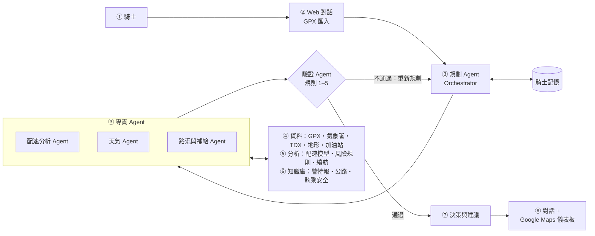
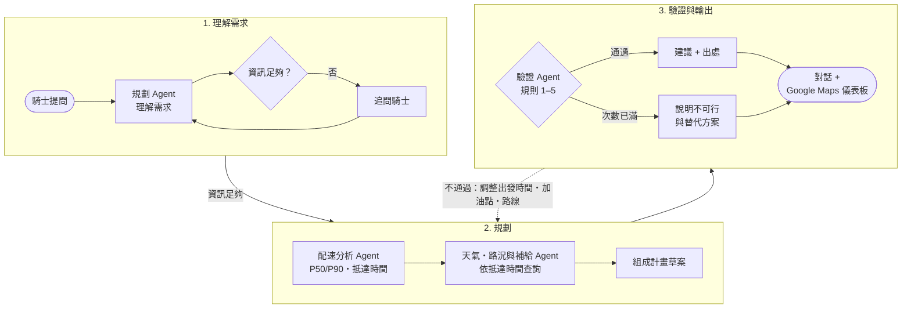

<!--
格式說明（給產生工具與審稿用）：
- 每一頁以「## 」開頭，標題就是投影片標題。
- 「layout:」指定版型：title（封面）、bullets（條列）、figure（大圖）、table（表格）、code（程式區塊）。
- 「### 逐字稿」之後到下一個「## 」之前是旁白，會放進備忘稿並轉成語音與字幕。
- 「來源：」那一行會以小字放在投影片底部。
- 內容只用 Proposal 已查證的數字；不寫任何實驗結果。
-->

## 重機旅遊規劃顧問

layout: title

- 結合個人配速模型與外部驗證的多 Agent 重機旅遊規劃系統
- AIoT-DA 期末專題提案　｜　第 12 組

### 逐字稿

大家好，我們這組的期末專題是「重機旅遊規劃顧問」。它是一個多 Agent 的規劃系統，用騎士自己的歷史行程學出個人配速，再結合天氣、路況和加油站資料，幫騎士在出發前回答一個很實際的問題：照我的騎法，這趟路能不能在天黑前平安騎回家。

## 為什麼要做這個題目

layout: bullets

- 台灣 2025 年道路交通事故死亡 2,858 人，只比前一年少 3.1%；其中機車使用者占 60.9%
- 大型重型機車登記數到 2025 年底約 28 萬輛，五年成長約 56%
- 南橫公路 2025 年兩次因颱風預防性封閉
- 台灣山區午後雷雨集中在下午三點到四點，沿山坡下緣最常發生

來源：交通部道安資訊查詢網；交通部公路局 114 年統計年報；中央社；Lin et al., Weather and Forecasting, 2011

### 逐字稿

先說為什麼值得做。根據交通部的資料，台灣二零二五年道路事故死亡兩千八百五十八人，只比前一年少百分之三點一，而且超過六成是機車使用者。大型重機的數量五年成長了大約一半以上。騎重機上山旅遊很常見，但山區的風險會隨時間改變：南橫公路去年就因為颱風兩次預防性封閉，山區午後雷雨也集中在下午三點到四點。什麼時候到哪裡，決定了這趟路安不安全。

## 騎士真正想問的問題

layout: bullets

- 「週六想騎南橫來回，幾點出發才能在天黑前回到家？中途哪裡加油？哪一段可能下雨或封路？」
- 個人化的時間預測：依我過去的騎法，每段要騎多久，並給出範圍
- 依抵達時間查風險：用「預計抵達該路段的時間」查天氣、日落和路況
- 一致性檢查：各段時間加總、回程是否在天黑前、加油距離是否在續航內，必須彼此吻合

### 逐字稿

騎士真正想問的，通常是這種問題：週六想騎南橫來回，幾點出發才能在天黑前回家？中途在哪裡加油？哪一段可能下雨或封路？要回答它，系統必須同時做到三件事。第一，依照這位騎士自己的騎法預測每段要騎多久，而且給出範圍。第二，用預計抵達每個路段的時間去查天氣、日落和路況，而不是只看出發地。第三，所有條件要互相吻合，時間、日照和油量都要說得通。

## 現有方法的不足

layout: bullets

- 一般導航：預估時間以整體車流訓練，是群體平均，不知道個別騎士在彎道和坡道的騎法
- 重機 App（Calimoto、Kurviger、REVER）：著重彎道路線與騎乘紀錄，沒有整合個人化時間、天氣與封路
- 只用 LLM：TravelPlanner 中 GPT-4-Turbo 的最終通過率只有 0.6%；MapEval 沒有模型在地圖推理超過 67%
- 資料分散：預報、日落、路況、加油站分屬不同平台，騎士要自己換算時間

來源：Google 台灣官方部落格；Derrow-Pinion et al., CIKM 2021；SlashGear 2025；Xie et al., ICML 2024；Dihan et al., ICML 2025

### 逐字稿

現有的工具都只解決了一部分。一般導航的預估時間是用整體車流訓練的，代表的是多數人的平均，不知道你在山路彎道騎多快。重機專用的 App 很擅長找彎道路線和記錄行程，但沒有把個人時間、天氣和封路放在一起看。如果直接交給大型語言模型呢？研究顯示，它在真實的行程規劃測驗裡，最終通過率只有百分之零點六，地圖推理也沒有模型超過六成七。再加上資料分散，最後還是要騎士自己查、自己算。

## 相關研究與技術演進

layout: table

| 方向 | 演進 | 仍然缺少的 |
| --- | --- | --- |
| 旅行時間預估 | 平均速度加總 → 端對端深度學習（DeepTTE）→ 圖神經網路（Google Maps）→ 機率分布（ProbETA） | 以城市汽車、群體平均為主，沒有個人化與山區彎道 |
| LLM 規劃 | 直接生成 → 外部 critic（LLM-Modulo）→ 形式化求解器 → 檢索增強（TP-RAG） | 只處理預算、班次與景點，不含依個人速度與天候的時間可行性 |
| 領域知識 | 機車彎道速度模型、彎道事故風險、台灣午後雷雨、颱風豪雨封路 | 各自獨立，沒有接到行程規劃 |

來源：Wang et al., AAAI 2018；Derrow-Pinion et al., 2021；Xu et al., 2025；Gundawar et al., 2024；Hao et al., NAACL 2025；Ni et al., EMNLP 2025；Lemonakis et al., 2021；Xin et al., 2019；Yang et al., 2012

### 逐字稿

相關研究可以分成三條線。旅行時間預估從平均速度加總，一路發展到深度學習、圖神經網路，再到輸出機率分布，但主要對象還是城市汽車和群體平均。大型語言模型的規劃研究則發現，光靠模型自己不行，要加上外部檢查、形式化求解器或檢索才會明顯改善，只是這些測驗只考預算和景點，沒有考時間可不可行。領域方面，機車彎道速度、彎道事故、台灣午後雷雨和颱風封路都有研究，但彼此沒有串起來。

## Research Gap 與本專題定位

layout: bullets

- Research Gap：目前沒有系統同時做到
  - 以單一騎士的歷史軌跡學出含地形與時段特徵的個人配速，並給出區間
  - 把配速區間和沿途天氣、日落、封路、加油距離放在同一份計畫
  - 由驗證者檢查時間與距離是否一致可行，不行就重新規劃
- 本專題：個人配速模型 + 依抵達時間的風險查詢 + 規劃與驗證分離的多 Agent
- 定位：個人化的出發前決策輔助，不做事故預測

### 逐字稿

所以我們看到的研究缺口是：還沒有一個系統，能用單一騎士自己的軌跡學出個人配速並給出範圍，把這個範圍和沿途的天氣、日落、封路、加油距離放進同一份計畫，再由驗證者檢查整份計畫是不是真的可行。我們的專題就是要補上這個缺口。要強調的是，這是出發前的決策輔助，我們不做事故預測，也不會宣稱系統能預防事故。

## 系統架構

layout: figure



### 逐字稿

這是系統架構，編號對應作業規範的八個模組。騎士透過網頁對話提問，也可以匯入自己的行程檔。核心是第三塊的多 Agent 規劃器：規劃 Agent 先理解需求，再分派給配速、天氣、路況與補給三個專責 Agent。它們向下使用資料來源、分析引擎和知識庫。整份計畫最後要通過驗證 Agent，才會變成建議，並以對話加上 Google 地圖儀表板呈現給騎士。

## 多 Agent 分工

layout: table

| Agent | 負責 | 主要工具 |
| --- | --- | --- |
| 規劃 Agent | 理解需求、拆解任務、分派與彙整計畫 | 知識庫檢索、騎士記憶 |
| 配速分析 Agent | 各段 P50／P90 時間與預計抵達時間 | 路線切段、地形特徵、個人配速模型、Google 兩輪車預估時間 |
| 天氣 Agent | 依各段抵達時間查天氣、警特報、民用暮光終 | 中央氣象署開放資料 |
| 路況與補給 Agent | 路況事件、加油站位置與營業時間、續航檢查 | 交通部 TDX、中油加油站資料、車系規格 |
| 驗證 Agent | 檢查整份計畫，不通過就退回重新規劃 | 確定性驗證規則 |

### 逐字稿

五個 Agent 各有明確分工。規劃 Agent 負責理解需求和整合結果。配速分析 Agent 算出每一段的時間範圍和預計抵達時間。天氣 Agent 拿這些抵達時間去查對應時段的預報和日落。路況與補給 Agent 查路況事件、加油站和續航。最關鍵的是驗證 Agent，它不靠語言模型判斷，而是用寫死的規則檢查計畫。整個系統的原則是，語言模型負責理解和解釋，所有數字都由工具計算。

## 對應課程框架：六大能力與 Level

layout: table

| 能力 | 本專題的做法 |
| --- | --- |
| TALK 會對話 | 多輪對話，主動追問缺少的條件 |
| KNOW 專業知識 | 知識庫：氣象署警特報、公路局資訊、騎乘安全、車系規格，回答附出處 |
| SENSE 取得資料 | 自己的 GPX 行程與政府開放資料；L3 加上騎乘中手機定位串流 |
| ANALYZE 資料分析 | 分位數梯度提升樹預測路段時間與區間，並和多個基準比較 |
| THINK 自主決策 | 多 Agent 分工、驗證不通過就重新規劃、記住騎士偏好 |
| SHOW 呈現成果 | 依時間與風險上色的地圖、時間軸、行程計畫；L3 加上語音提醒 |

Level：L1 對話與資料分析（包含在 L2 內）　｜　L2 知識型多 Agent（承諾完成）　｜　L3 騎乘中即時提醒（延伸）

### 逐字稿

對照課程提出的六大能力，這個系統都有明確對應。會對話，是多輪問答並主動追問；專業知識，靠的是附出處的知識庫；取得資料，來自自己的行程和政府開放資料；資料分析，是個人配速模型；自主決策，是多 Agent 加上驗證與重新規劃；呈現成果，則是依時間和風險上色的地圖。實作範圍上，我們承諾完成第二級的知識型 Agent，騎乘中的即時提醒列為第三級延伸。

## 個人配速模型

layout: bullets

- 資料：騎士自己的 279 趟 GPX（約 1 秒一點），每段實際騎乘時間就是正確答案
- 特徵：彎道曲率、坡度（內政部地形）、道路等級、急彎與陡坡標記、時段、天氣、已騎里程
- 模型：多元迴歸（課程 L6）→ LightGBM 分位數損失，輸出每段 P50 與 P90
- 整趟範圍：各段 P90 直接相加會高估，改為各段 P50 加總，再以保留行程校正整趟 P90（conformal）
- Baseline：平均速度、速限換算、Google Maps 兩輪車預估時間（Routes API 支援台灣）

### 逐字稿

分析的核心是個人配速模型。我們手上有二七九趟自己的行程，每一段實際騎了多久，就是模型要學的答案。特徵包括彎道曲率、坡度、道路等級和時段天氣。模型先用課堂教過的多元迴歸當基準，再用分位數損失的梯度提升樹，輸出一般情況和保守情況兩個時間。這裡有個細節：每段的保守時間直接相加會嚴重高估，所以我們用歷史行程校正整趟的範圍。最後會和平均速度、還有 Google 地圖的兩輪車預估時間比較。

## 驗證規則與出發時間決策

layout: bullets

- 規則 1 日照：出發時間加上整趟 P90，必須早於民用暮光終與騎士設定的回程時間
- 規則 2 續航：補給點間距不超過續航扣除安全餘裕，且抵達加油站時有營業
- 規則 3 天氣：抵達時落在大雨以上警特報的路段標為高風險
- 規則 4 路況：路段有封閉或管制事件時，計畫不可行
- 規則 5 可追溯：回答中的每個時間、距離、機率都必須來自工具輸出
- 決策：在可行的候選出發時間中，選回程餘裕最大、高風險路段最少者；沒有可行解就說明原因與替代方案

### 逐字稿

驗證 Agent 有五條硬規則。第一，保守估計的回程時間必須早於天黑。第二，加油點之間不能超過續航，而且抵達時加油站要有開。第三，抵達時正好碰上大雨警報的路段要標為高風險。第四，有封路事件就不可行。第五，回答裡每個數字都要能追溯到工具輸出。系統會在所有可行的出發時間裡，挑出回程餘裕最大的一個；如果都不可行，就老實說明原因，並提出縮短路線或改日之類的替代方案。

## 處理流程

layout: figure



### 逐字稿

這是完整的處理流程。如果騎士匯入的是行程檔，系統就清理資料、切路段，更新個人配速模型。如果是提問，規劃 Agent 先確認資訊夠不夠，不夠就追問。接著配速、天氣、路況與補給三個 Agent 依序產生資料，組成計畫草案，再交給驗證 Agent。不通過就調整出發時間、加油點或路線，重新規劃，並設有次數上限。外部資料取得失敗時，系統會直接說明，不會用猜的補值。

## 核心演算法

layout: code

```text
Algorithm 1: Plan with Verification
01: ctx ← UNDERSTAND(Q, MEMORY(u))
02: if MISSING(ctx) then return ASK_RIDER()
03: route ← BUILD_ROUTE(ctx); X ← SEGMENT_FEATURES(route)
04: repeat
05:   for each departure d in CANDIDATES(ctx) do
06:     (t50, ETA) ← PACE_AGENT(X, d, u)
07:     T90 ← Σ t50 + BREAKS + CONFORMAL_Q90(u)
08:     W ← WEATHER_AGENT(route, ETA)
09:     F ← SUPPLY_AGENT(route, ETA, VEHICLE(u))
10:     plan ← COMPOSE(d, t50, T90, W, F, SEARCH(KB))
11:     if VERIFY(plan) and SLACK(plan) > SLACK(best) then best ← plan
12:   if best = ∅ then ctx ← REPLAN(ctx, violations)
13: until best ≠ ∅ or attempts ≥ MAX
14: return best ≠ ∅ ? RENDER(best) : INFEASIBILITY_REPORT()
```

### 逐字稿

這是核心演算法的精簡版。前三行是理解需求、缺資訊就追問，然後建立路線、切段算特徵。接著對每個候選出發時間，依序取得配速、天氣和補給資訊，第七行用各段的一般時間加總，再加上校正量，得到整趟的保守時間。第十一行是驗證：只有通過規則、而且回程餘裕更大的計畫，才會被留下來。如果一個都沒有，就依違反的規則重新規劃，直到找到可行計畫或達到次數上限。

## Deep Research 重點

layout: bullets

- 五個核心思維模式：以最難的路段規劃，不看平均速度；山區天氣看時間窗；日光與騎乘時數是硬限制；補給看抵達時有沒有開；山區道路狀態是動態的
- 爭論 1：LLM Agent 能自我修正，還是必須依賴外部驗證器？→ 本專題採外部驗證
- 爭論 2：配速模型要個人化，還是用可轉移的通用模型？→ 個人化，並以 Google 預估時間作基準
- 爭論 3：ABS 等電子輔助的效益，會不會被風險補償抵銷？→ 決策用 P90 而非 P50，避免系統讓騎士更冒險

來源：TxDOT Roadway Design Manual；中央氣象署；IIHS／HLDI；Valmeekam et al., 2023；Geedipally et al., 2017

### 逐字稿

在領域研究上，我們整理出五個專家共同的思維模式，例如規劃要看最難的路段，不能看平均速度；山區天氣要看時段；日照是硬限制。每一條都直接變成系統的規則。我們也整理了三個仍有爭論的問題。第三個特別值得一提：電子輔助系統可能讓騎士騎得更冒險，我們的系統本身也是一種輔助，所以決策一律用保守的時間範圍，避免騎士因為信任系統而壓縮安全餘裕。

## 評估計畫

layout: table

| 實驗 | 問題 | 方法與指標 |
| --- | --- | --- |
| E1 配速模型 | 個人模型比一般導航準嗎？ | 平均速度、速限換算、Google 預估時間 vs 多元迴歸 vs LightGBM；依行程分組交叉驗證與時間外推；MAE、MAPE、P90 覆蓋率 |
| E2 消融實驗 | 外部驗證能提高可行率嗎？ | 20–30 題規劃問題；只用 LLM vs LLM + 知識庫 vs 完整 Agent；計畫可行率、時間誤差、數字可追溯率 |
| E3 風險規則 | 抓得到歷史封路日嗎？ | 以封路紀錄回測；命中率、誤報率、敏感度分析 |
| E4 案例研究 | 對騎士有沒有價值？ | 2–3 個完整情境；用過去行程回測預測回程時間 |

預期成果（待驗證）：個人配速模型在彎道密集的山區路段比一般導航更貼近實際；完整 Agent 的計畫可行率高於只用 LLM。本提案不含實驗結果。

### 逐字稿

評估分成四個實驗。第一個驗證配速模型，和平均速度、Google 預估時間比較，看誤差和保守範圍的覆蓋率。第二個是消融實驗，用同一批規劃問題，比較只用語言模型、加上知識庫、以及完整 Agent 的計畫可行率，這直接回答工具和驗證到底帶來多少改善。第三個用歷史封路紀錄回測風險規則，第四個做完整的案例研究。我們預期個人模型在山路會更準，但這些都還是待驗證的假設，這份提案沒有任何實驗結果。

## 可行性、限制與時程

layout: bullets

- 資料已到位：279 趟 GPX（已檢查取樣約 1 秒一點）；氣象署、TDX、地形、公路局、加油站、Google 兩輪車路線都已確認可取得
- 方法已跑通：同一套「切段、特徵、多元迴歸與梯度提升樹、分組交叉驗證」流程已在公開汽車資料集 VED 上驗證（不同資料集，只證明流程可行）
- 限制：只有一位騎士（n = 1）；封路沒有機器可讀的歷史資料；風險評分沒有正確答案
- 範圍：承諾 L2（知識庫 + 多步推理 Agent + 資料分析）；L3（騎乘中手機定位回傳與語音提醒）為延伸
- 接下來：GPX 驗證、建立 GitHub repo 與 DESIGN.md、實作配速模型與 Agent

### 逐字稿

最後談可行性和限制。資料方面，二七九趟行程已經在手上，政府開放資料和 Google 兩輪車路線也都確認可以取得。方法方面，同一套分析流程已經在公開的汽車資料集上跑通，不過那只證明流程可行，不是這個題目的結果。限制也很清楚：只有一位騎士，封路沒有歷史資料，風險評分沒有標準答案。以上是我們的提案，謝謝大家。
