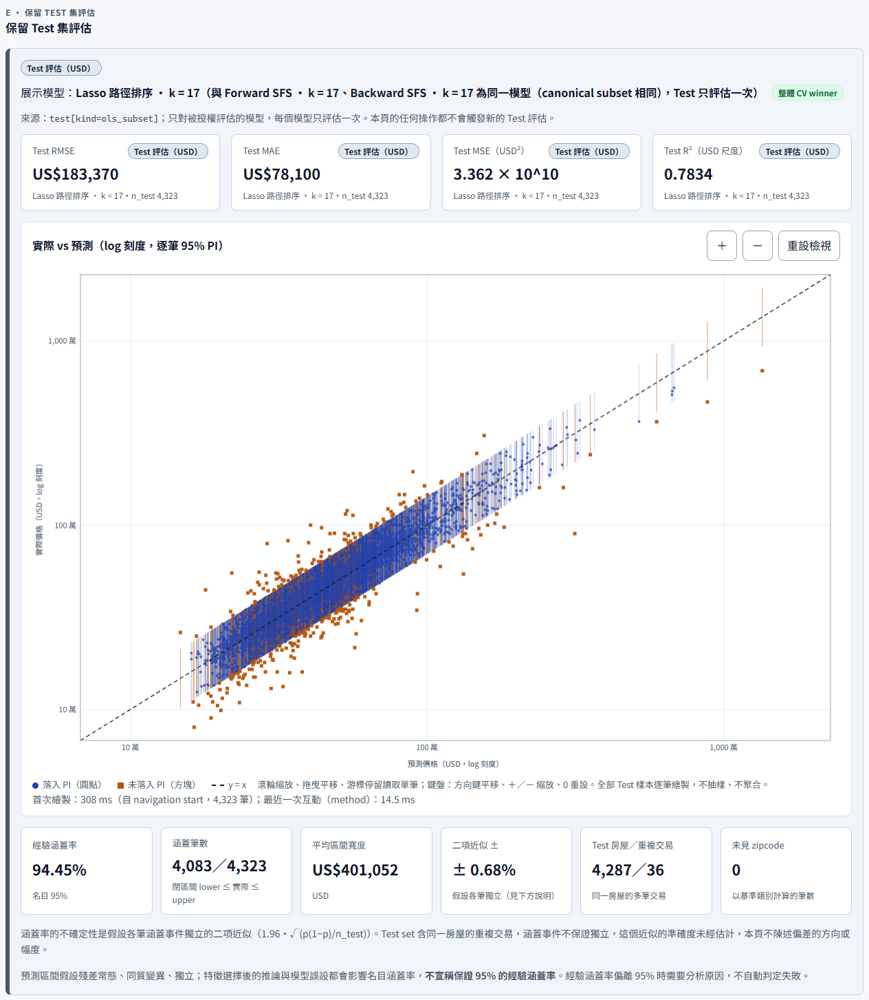
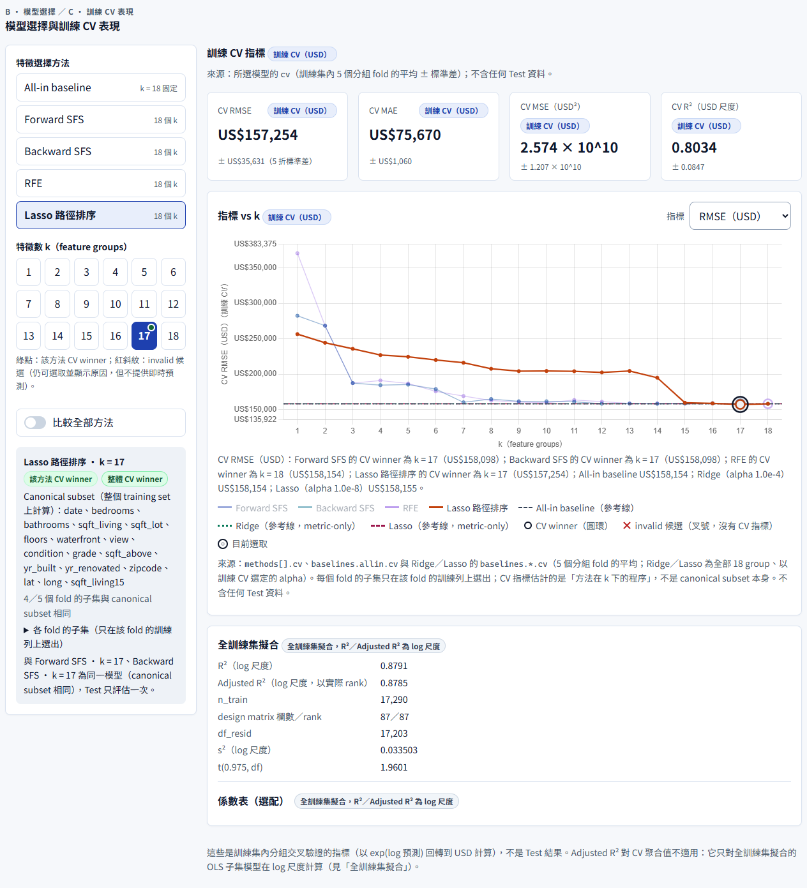

# HW2 — King County 房價多元線性回歸

## 專案資料

- **課程名稱**：AIoT 與數據分析（AIoT & Data Analytics, AIoT-DA）
- **作業**：HW2 Multiple Linear Regression（多元線性回歸，依 CRISP-DM 完成分析）
- **完成日期**：2026-10-19（合併進 `main`，PR #68）
- **儲存庫網址**：[github.com/yotsubamomo/aiot-classwork](https://github.com/yotsubamomo/aiot-classwork)（本作業在 `home_work_02/`）
- **Dashboard（GitHub Pages）**：<https://yotsubamomo.github.io/aiot-classwork/home_work_02/>

## Dashboard（課堂口頭要求）

[](https://yotsubamomo.github.io/aiot-classwork/home_work_02/)

> 點擊圖片可開啟 GitHub Pages 上的 dashboard。截圖以報告建置所用的擷取程式 `report/chrome_capture.js`，在本機以 Chrome 從本單元的 `index.html` 擷取；dashboard 只讀取追蹤的匯出結果，所以內容與 Pages 上相同。畫面中的繪製與互動時間是擷取當下的量測。



- GitHub Pages：<https://yotsubamomo.github.io/aiot-classwork/home_work_02/>（發布自 `main`）
- 本機或繳交 ZIP：直接以瀏覽器開啟 `index.html`（`file://`），不需要網路或伺服器；Chart.js 打包在 `assets/vendor/`，頁面不發出任何對外請求。
- Dashboard 只讀取匯出的結果：任意 (方法, k) 顯示訓練 CV 指標與即時預測，Test 區塊只呈現被授權評估的模型，任何操作都不會觸發新的 Test 評估。
- Dashboard 是老師的課堂口頭要求，作業頁正文沒有要求網站；它是額外交付，不取代任何老師要求的檔案。

## 專案摘要

以 Kaggle「House Sales in King County, USA」資料集，依 CRISP-DM 六階段完成多元線性回歸分析：特徵選擇比較、以房屋分組的交叉驗證選模、只評估一次的保留 Test 集、逐筆 95% 預測區間，並以離線可用的靜態 dashboard 呈現結果。

一份 notebook、三個呈現：

- **主程式** [`hw2.ipynb`](hw2.ipynb)：CRISP-DM 六章，呼叫 [`hw2/`](hw2/) 套件；是所有數字的唯一來源，結果匯出到 [`results/`](results/)。
- **PDF 報告**：由 [`report/report.md`](report/report.md) 建置，數字、表與圖在建置時從匯出結果注入。
- **Dashboard**：[`index.html`](index.html)＋[`assets/`](assets/)，只讀取匯出的 `model_data`。

## 目的

- 以房屋的條件（面積、房間數、建築等級、屋齡與整修、位置、交易日期）預測成交價格，並為每一筆預測給出有統計定義的 95% 預測區間。
- 依作業要求執行特徵選擇：比較四種能對每個 k 給出子集的方法（Forward SFS、Backward SFS、RFE、Lasso 路徑排序，k = 1…18；方法取自作業頁「補充」段建議清單的一部分）與單一的 All-in baseline，只用 training set 的交叉驗證選模。
- 交付老師要求的主程式、PDF 報告、AI 協助證據與學號 ZIP，加上課堂口頭要求的互動 dashboard。

## 已實作功能

標示沿用報告的三種標示：〔老師要求〕、〔依老師補充建議〕、〔專案延伸〕；dashboard 是課堂口頭要求。

**分析（notebook＋`hw2/` 套件）**

- 〔老師要求〕載入時核對資料檔的 sha256，不符即停止；CRISP-DM 六章依序執行。
- 〔老師要求〕四種特徵選擇方法對每個 k 給出子集，與 All-in baseline 一起以訓練 CV 選模；方法清單取自補充段建議清單的一部分。
- 〔專案延伸〕以房屋 `id` 分組的切分與交叉驗證、fold 內選擇（每個 fold 只在自己的訓練列上重新選擇）、只評估一次的 Test 協定；以 ln(price) 建模、以 USD 報告。
- 〔老師要求〕實際 vs 預測圖加上逐筆 95% 預測區間；〔專案延伸〕預測區間的經驗涵蓋率驗證。
- 〔依老師補充建議〕Adjusted R²（只對 OLS 子集模型、log 尺度）、五大回歸假設診斷（只用 training set）、Deployment 的預測新樣本（`predict_price()`）與模型解釋、Ridge／Lasso 對照（metric-only）。
- 〔專案延伸〕講義的 p-value backward elimination 對照、permutation importance（只用於解釋）、各方法計算時間的量測、最終模型的 pickle 示範。

**Dashboard（課堂口頭要求）**

- 概覽、模型選擇與訓練 CV、指標 vs k（可比較全部方法）、即時房價預測、保留 Test 集評估、方法與限制。
- 任意 (方法, k) 的 KPI 與係數表使用訓練 CV 與全訓練集擬合，標示「訓練 CV」；Test 區塊標示展示的方法與 k，與目前選取的模型不同時有提示。
- 預測器的輸入檢查與警告（含未見 zipcode）；實際 vs 預測圖可縮放、拖曳、逐筆讀取。
- 完全離線：`file://` 開啟、零對外請求，Chart.js 打包在單元內。

**報告與交付**

- PDF 報告：CRISP-DM 六章、資料來源與研究脈絡、「GPT 輔助內容」、「NotebookLM 摘要」、主流或更優解法比較、dashboard 連結與截圖、附錄 ChatGPT 對話 PDF；前段附三種標示的對照表。
- 繳交檔名 `<學號>_hw2.ipynb`、`<學號>_hw2.zip` 由打包步驟自同一份 notebook 產生。

## 作業要求對應

| 作業頁正文的要求 | 本專案 |
| --- | --- |
| 資料來源：Kaggle 公開資料集，10–20 個特徵，標示來源與連結 | King County 房屋銷售資料，見「資料來源與授權」；特徵數另採補充段條件的交集，說明在報告第一章 |
| 分析任務：線性回歸預測，必做特徵選擇與模型評估 | [`hw2.ipynb`](hw2.ipynb) 第 4、5 章；[`hw2/selection.py`](hw2/selection.py)（特徵選擇路徑）、[`hw2/models.py`](hw2/models.py)（分組 CV 與 CV winner）、[`hw2/testgate.py`](hw2/testgate.py)（Test 評估守門） |
| 預測圖加上信賴區間或預測區間 | 逐筆 95% 預測區間：notebook 5.5.1 與 [`results/figures/`](results/figures/)；dashboard 的 Test 區塊 |
| CRISP-DM 流程說明（六階段） | notebook 與報告各有六章，見「流程（CRISP-DM）」 |
| AI 協助要求：ChatGPT 對話 PDF、NotebookLM 摘要（100 字以上）、標示「GPT 輔助內容」與「NotebookLM 摘要」 | 報告的對應兩節與附錄；作者的原始材料只在本機，不進 git |
| 繳交內容：主程式、PDF 報告、學號命名的 ZIP | `<學號>_hw2.ipynb`、報告 PDF、`<學號>_hw2.zip`，由作者在本機打包 |
| （optional）上傳 GitHub 時提供連結，並在 README 整理流程與成果 | 本檔；本專案使用 GitHub，所以適用 |
| 評分：Kaggle 名次（若有）／預測結果評估 | King County 沒有競賽名次，以 Test 評估指標與預測圖呈現，見「成果」 |

- 〔依老師補充建議〕採用的補充建議：Adjusted R²、五大回歸假設診斷、Deployment 的預測新樣本與模型解釋、Ridge／Lasso 對照。它們不是作業頁正文的要求。
- 互動 dashboard 是課堂口頭要求，見「Dashboard（課堂口頭要求）」。
- 每條要求與決定的檢查與證據逐條列在驗收清單 [`doc/acceptance/ACCEPTANCE.md`](doc/acceptance/ACCEPTANCE.md)。

## 資料來源與授權

- 資料集：[House Sales in King County, USA](https://www.kaggle.com/datasets/harlfoxem/housesalesprediction)（Kaggle `harlfoxem/housesalesprediction`），授權 CC0: Public Domain。
- 檔案：`data/kc_house_data.csv`（21,613 列 × 21 欄），sha256 `d0875baa0251b21d4bdc9d2ae940a4fe0bb6009824f23dd0e2a5b2bf04557b7e`；載入時先核對 sha256，不符即停止。

## 流程（CRISP-DM）

主程式 `hw2.ipynb` 依序是六章，每一章呼叫 `hw2/` 套件的公開函式：

1. **Business Understanding**：預測目標、使用者與成功的衡量。
2. **Data Understanding**：結構核對（sha256、欄位、列數、唯一 `id`、`sqft` 恆等式）；分布與極端值只用 training set 檢視，異常值不刪除。
3. **Data Preparation**：固定轉換（交易日期 → 天數、整修年 → 旗標＋有效年份、zipcode 為類別）；以房屋 `id` 分組的 80/20 切分與 training 內的 5 個分組 fold；需要 fit 的前處理只看當次訓練列；以 ln(price) 建模、USD 報告。
4. **Modeling**：四種特徵選擇方法在每個 fold 的訓練列上重新選出 k = 1…18 的子集（fold 內選擇），All-in baseline；Ridge／Lasso 對照（依老師補充建議，metric-only）；講義的 p-value backward 對照。
5. **Evaluation**：各方法與整體 CV winner；全部選擇固定後，保留 Test 集只評估一次（各方法 CV winner、All-in、整體 CV winner，加上 Ridge／Lasso 各一次）；逐筆 95% 預測區間與經驗涵蓋率；Adjusted R² 與五大回歸假設診斷（依老師補充建議，只用 training set）。
6. **Deployment**：dashboard；`predict_price()` 預測新樣本；模型解釋（係數的百分比讀法、標準化與 one-hot 的讀法、permutation importance）；pickle 示範；使用限制。

## 成果

數字取自匯出結果 `results/model_data.json`（`tests/test_report.py` 核對本節的每個數字與匯出結果一致）；完整的表與圖見報告與 `results/`。

- **整體 CV winner（最終模型）**：Lasso 路徑排序 k = 17（canonical subset 與 Forward SFS k = 17、Backward SFS k = 17 相同，是同一個模型）。
- **保留 Test 集**（4,323 筆，只評估一次）：RMSE 183,370 USD、MAE 78,100 USD、R² 0.783（USD 尺度）。
- **95% 預測區間的經驗涵蓋率**：94.45%（4,083／4,323）。
- 五大回歸假設在 training 殘差上都偵測到偏離，依規則揭露、不判定失敗；所以不宣稱保證 95% 的涵蓋率。

報告（PDF）由 `python -m hw2.report` 建置，數字、表與圖全部在建置時從匯出結果注入。

## 技術棧

| 層 | 使用技術 |
| --- | --- |
| 分析 | Python 3.11、numpy、pandas、scipy、scikit-learn、matplotlib；版本鎖定在 [`requirements.txt`](requirements.txt) |
| 主程式 | Jupyter notebook [`hw2.ipynb`](hw2.ipynb)；`python -m hw2.run_notebook` 以 nbclient 非互動執行 |
| 分析套件 | [`hw2/`](hw2/)：資料、前處理、分割、特徵選擇、OLS 與預測區間、Test 評估守門、`model_data` 匯出、診斷、解釋、報告建置、打包 |
| Dashboard | 靜態 HTML／CSS／JavaScript，無建構步驟、無後端；Chart.js 打包在 `assets/vendor/`；`assets/hw2core.js` 是 dashboard 自己的前處理與預測計算 |
| 報告 | Markdown 模板 [`report/report.md`](report/report.md) → HTML → PDF；Node.js 驅動 Chrome 或 Edge 擷取 dashboard 截圖與列印 PDF |
| 測試 | pytest（[`tests/`](tests/)）；dashboard 計算的 Node 測試（[`tests/js/`](tests/js/)）；dashboard 外部資源靜態掃描（`python -m hw2.offline_scan`） |
| 發布 | GitHub Pages（發布自 `main`）；不使用後端、API、資料庫或 Vercel |

## 重跑步驟（Windows，Python 3.11）

在 `home_work_02/` 目錄執行：

```bash
py -3.11 -m venv .venv
.venv/Scripts/python -m pip install -r requirements.txt
.venv/Scripts/python -m hw2.run_notebook      # 非互動執行 hw2.ipynb，重現唯一一次的 Test 評估，寫出 results/ 與 assets/model_data.js
.venv/Scripts/python -m pytest                # Python 測試（含以 synthetic fixture 執行的 Node 一致性測試）
.venv/Scripts/python -m hw2.offline_scan      # dashboard 外部資源靜態掃描
node --test tests/js/core.test.js             # dashboard 計算的 Node 測試
.venv/Scripts/python -m hw2.report            # 建置報告：dist/report/hw2_report.md、.html、.pdf
.venv/Scripts/python -m hw2.package           # 作者繳交前的打包步驟，需要本機、不進 git 的輸入
```

- **報告建置**需要 Node.js 與 Chrome 或 Edge（擷取 dashboard 截圖、列印 PDF；找不到瀏覽器時以環境變數 `HW2_BROWSER` 指定執行檔）。`--no-pdf` 只產生 Markdown 與 HTML；`--final` 在 AI 證據章節仍是【待填】時失敗。建置前會核對匯出的 Test 結果就是唯一一次正式評估的結果，不符就拒絕建置。AI 證據章節（「GPT 輔助內容」的 ChatGPT 部分、「NotebookLM 摘要」、附錄 B 的 ChatGPT 對話 PDF）在建置時讀取本機的 `acceptor_materials/`：材料的 sha256 必須與收件紀錄相同，否則拒絕建置；NotebookLM 摘要必須至少 100 個漢字，且每一句都在對照表中；PDF 版本把 ChatGPT 對話 PDF 的原頁接在報告最後。材料不存在時只有對應章節以【待填】標示，其他章節照常建置。
- **Test 評估只有一次**：唯一一次正式 Test 評估在 notebook 第 5.4 節、全部選擇（各方法 CV winner、整體 CV winner、Ridge／Lasso 的 alpha）只用 training set 固定之後執行，執行識別 `fe76019b9af84b1e8ff46095d5ac0fb2`、Test 結果摘要（`test_inputs` 與 `test` 的 sha256）`b53ff286ae0734add8b272089aba904a1cb7f5aca444a62d356420b25dc3cfc6`；權威紀錄在 `doc/governance/worklog/issue-63.md` §5。`model_data` 的 `meta.test_evaluation` 只記錄**產生目前這份檔案的那次執行**；完整重跑 notebook 是以相同的 seed 與鎖定版本**重現**同一個評估，不是新的評估，結果必須與上述摘要完全相同（bit-exact），不一致時不得採用新數字。同一次執行內第二次評估會被拒絕。
- 四種方法的路徑計算時間每次重跑都會量測，寫在 `model_data` 的 `meta.timing_s`（`path_<方法>`）與 `meta.path_timing_s`，notebook 第 4.2 節與報告也會列出；Ridge／Lasso、p-value backward 與 Test 評估的時間在 `meta.timing_s` 與 `meta.comparison_timing_s`。
- 要在單元目錄**以外**產生一份使用 synthetic fixture 的 dashboard 複本（例如量測繪圖效能；不是正式結果，頁面頂端會顯示警告）：`.venv/Scripts/python -m hw2.fixture <單元以外的輸出目錄>`。
- macOS／Linux 把 `.venv/Scripts/python` 換成 `.venv/bin/python`。

### 本機、不進 git 的材料與輸出

以下路徑都列在 `home_work_02/.gitignore`，不得加入版本控制：

| 路徑 | 內容 |
| --- | --- |
| `acceptor_materials/` | ChatGPT 對話 PDF、NotebookLM 原始輸出與來源清單（作者提供）；`derived/` 是 Claude Code 依這些材料整理的報告章節與 NotebookLM 摘要的對照表，同樣不進 git |
| `dist/` | 建置與打包輸出（`dist/report/` 的報告；`<學號>_hw2.ipynb`、`<學號>_hw2.zip`） |
| `.venv/` | 虛擬環境 |

## 檔案配置

```text
home_work_02/
├── README.md               # 本檔：專案說明
├── CONTEXT.md              # 專案語彙
├── hw2.ipynb               # 主程式（CRISP-DM 六章；唯一的數字來源）
├── hw2/                    # 分析套件
├── requirements.txt        # 鎖定版本的相依套件
├── data/                   # kc_house_data.csv
├── results/                # 匯出結果：model_data.json、split/、tables/、figures/、deployment/
├── index.html · assets/    # Dashboard（assets/model_data.js、hw2core.js、app.js、vendor/）
├── report/                 # 報告來源
├── tests/                  # pytest；tests/js/ 是 dashboard 計算的 Node 測試
└── doc/                    # 題目、brief、spec、票務索引、驗收清單、README 截圖與治理紀錄
```

| 路徑 | 說明 |
| --- | --- |
| `hw2.ipynb` | 主程式（CRISP-DM 六章；唯一的數字來源） |
| `hw2/` | 分析套件：資料、前處理、分割、四種特徵選擇方法的 k 路徑（`selection`）、OLS 與預測區間、模型候選與 CV winner、Ridge／Lasso 對照與講義的 p-value backward（`comparison`）、Test 評估守門、`model_data` 契約與匯出、最終模型與 `predict_price()`（`deployment`）、五大假設診斷（`diagnostics`）、模型解釋（`explain`）、預測圖（`prediction_plot`）、報告建置（`report`）、打包（`package`）、synthetic fixture、離線掃描 |
| `report/` | 報告來源：`report.md`（zh-TW Markdown；數字以佔位符在建置時注入）、`external_sources.json`（主流解法比較的公開來源與其自報數字）、`chrome_capture.js`（建置時擷取 dashboard 截圖與列印 PDF） |
| `tests/` | pytest；`tests/js/` 是 dashboard 計算的 Node 測試 |
| `data/kc_house_data.csv` | 資料檔 |
| `results/model_data.json`、`assets/model_data.js` | 匯出的 `model_data`（同一物件；`.js` 供 `file://` 載入） |
| `results/split/split_assignment.csv` | 每筆交易屬於 training 或 Test 與其 fold（只有識別，沒有特徵或價格） |
| `results/tables/` | 結果表 CSV：`cv_by_method_k.csv`（各方法各 k 的訓練 CV）、`comparison.csv`（各方法 CV winner、All-in、Ridge、Lasso 與 p-value 對照；`cv_*` 為訓練 CV、`test_*` 為 Test 評估，分欄）、`alpha_cv.csv`（Ridge／Lasso 的 alpha 交叉驗證曲線）；最終模型（只用 training set）的 `diagnostics_summary.csv`、`diagnostics_vif_by_group.csv`、`diagnostics_vif_by_column.csv`、`final_model_coefficients.csv`、`permutation_importance_training.csv` |
| `results/figures/` | 實際 vs 預測＋逐筆 95% 預測區間的預測圖（notebook 5.5.1，只讀匯出的 Test 結果）、診斷圖與解釋圖（notebook 5.6 與第 6 章）PNG；報告引用 |
| `results/deployment/final_model.pkl` | 最終模型的 pipeline（Deployment 的 pickle 示範；dashboard 不讀取它）。pickle 載入時會執行程式碼，只載入本專案 notebook 產生的檔案 |
| `index.html`、`assets/` | Dashboard；`assets/hw2core.js` 是 dashboard 自己的前處理與預測計算，`assets/app.js` 是頁面；Chart.js 4.4.1 打包在 `assets/vendor/`（MIT，授權檔同目錄） |
| `doc/` | 需求（老師原文，唯讀）、Brief、Spec、票務索引、驗收清單 `doc/acceptance/ACCEPTANCE.md`、本檔的 dashboard 截圖 `doc/screenshots/` 與治理紀錄 |

## 驗證紀錄

- `pytest`：資料核對、分組切分、特徵選擇路徑、Test 評估守門、`model_data` 契約、報告建置與數字單一來源、README 的章節與數字、驗收清單的狀態、打包，以及追蹤檔案不含實際學號與作者材料。
- Node 測試：dashboard 的前處理與預測計算與 Python 一致；`hw2.offline_scan` 確認 dashboard 沒有外部資源。
- 乾淨環境重跑（新建虛擬環境、安裝、非互動執行 notebook、測試、建置報告、打包）與 dashboard 人工檢查（含 `file://` 離線與 GitHub Pages）的結果，逐條記在 [`doc/acceptance/ACCEPTANCE.md`](doc/acceptance/ACCEPTANCE.md)，證據在 [`doc/governance/worklog/`](doc/governance/worklog/)。

## 詳細文件

| 文件 | 內容 |
| --- | --- |
| [`CONTEXT.md`](CONTEXT.md) | 專案語彙：分組切分、特徵選擇路徑、CV winner、一次性 Test 評估、metric-only 模型、預測區間等用詞定義 |
| [`doc/requirement/`](doc/requirement/) | 老師的作業頁與講義（原文與逐字轉寫，唯讀） |
| [`doc/brief/BRIEF.md`](doc/brief/BRIEF.md) | 需求盤點與範圍決定 |
| [`doc/spec/SPEC.md`](doc/spec/SPEC.md) | 實作 spec |
| [`doc/ticket/tickets.md`](doc/ticket/tickets.md) | 票務索引（票本體在 GitHub Issues） |
| [`doc/acceptance/ACCEPTANCE.md`](doc/acceptance/ACCEPTANCE.md) | 逐條驗收清單與證據位置 |
| [`doc/governance/`](doc/governance/) | Outcome Contract、決策紀錄、worklog、audit 與 run 紀錄 |
